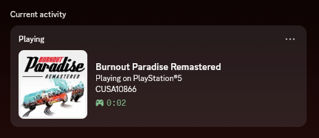
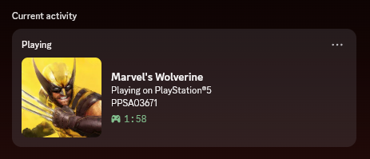

# ps5-discord-rpc
Discord RPC for jailbroken PS5 consoles.

## Screenshots
| Burnout Paradise Remastered                                                                                   | Marvel's Wolverine                                                                 |
|---------------------------------------------------------------------------------------------------------------|------------------------------------------------------------------------------------|
|  |  |

## Usage
For the server, simply run [`ps5-discord-rpc.elf`](https://github.com/azurejelly/ps5-discord-rpc/releases) on a jailbroken console. It will be accessible on port `7270`. For the client, install whatever the latest Python version is as of writing this and run the [client](./client/main.py).

## Building the payload
Assuming you already have all dependencies installed:
```sh
$ git clone https://github.com/azurejelly/ps5-discord-rpc
$ cd ./ps5-discord-rpc/server/
$ export PS5_PAYLOAD_SDK=/opt/ps5-payload-sdk
$ make
```

You will find the .elf file inside the `build/` folder.
